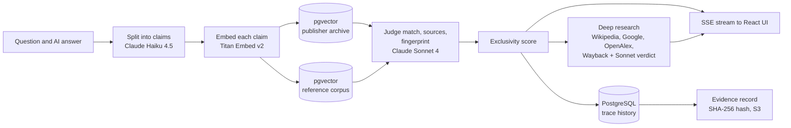

# CoMP Ledger

**Shows whether an AI model's answer came from a publisher's reporting, claim by claim, and exports a tamper-evident evidence record.**

**Winner, AWS Publishing & Media Innovation Hackathon, NYC (July 2026)**


## Contents

- [The problem](#the-problem)
- [At a glance](#at-a-glance)
- [How a trace works](#how-a-trace-works)
- [Scoring model](#scoring-model)
- [Deep research mode](#deep-research-mode)
- [Ways to run a check](#ways-to-run-a-check)
- [Getting publisher content in](#getting-publisher-content-in)
- [Evidence record](#evidence-record)
- [Architecture](#architecture)
- [Engineering decisions](#engineering-decisions)
- [Three implementations](#three-implementations)
- [Tech stack](#tech-stack)
- [Run it locally](#run-it-locally)
- [API overview](#api-overview)
- [Repository layout](#repository-layout)

## The problem

AI assistants repeat news publishers' reporting, but model makers don't disclose their training data, so a publisher can't prove which of its articles a model learned from. CoMP Ledger looks at the answer instead of the training set. It asks a narrower question that can actually be checked: **is this specific claim in the answer something only this publisher reported?** If a model repeats a fact that appears in one outlet's archive and almost nowhere else, that is a strong signal, and it is the kind of evidence a publisher can bring to a licensing conversation.

## At a glance

| | |
|---|---|
| **Input** | A question and an AI answer, pasted in or generated live from a Bedrock model |
| **Output** | Every factual claim in the answer, each with a match to the publisher's archive, an independent source count, a distinctive phrase check and an exclusivity score from 0 to 1 |
| **Speed to first result** | Claims stream to the UI over Server-Sent Events as each one is scored, so nothing waits for the whole answer |
| **Evidence** | A JSON record with a SHA-256 integrity hash, written to S3 |
| **Backend surface** | 41 REST endpoints in the main Node.js API |
| **Built three times** | Node.js (main), Java with Spring Boot, Python with FastAPI |

## How a trace works

1. **Get the answer.** The user pastes an AI answer, or picks a model and CoMP Ledger generates one through Amazon Bedrock (Claude Haiku 4.5, Claude Sonnet 4, Amazon Nova Micro, Nova Lite or Llama 3.1 8B).
2. **Break it into claims.** Claude Haiku 4.5 splits the answer into atomic factual claims, so a sentence with three facts becomes three checkable items.
3. **Embed each claim.** Amazon Titan Text Embeddings v2 turns each claim into a 512 dimension vector.
4. **Retrieve candidates.** pgvector returns the 5 nearest passages from the publisher's archive and the 5 nearest from a public reference corpus, using cosine distance over an HNSW index.
5. **Judge the evidence.** Claude Sonnet 4 reads the claim next to both candidate sets and returns structured JSON: does the publisher's text support the claim, how many independent sources also carry it, and did the answer reuse a distinctive phrase.
6. **Score it.** The judgement becomes an exclusivity score (formula below).
7. **Stream it.** Each scored claim is pushed to the React UI as an SSE event the moment it is ready.
8. **Save and export.** The trace is stored in PostgreSQL, and the user can export it as an evidence record to S3.

## Scoring model

```
baseScore        = max(0.05, 1 / (1 + independentSourceCount * 0.8))
fingerprintBonus = 0.15 if a distinctive phrase from the publisher is detected, else 0
exclusivityScore = min(1.0, baseScore + fingerprintBonus)
```

The fewer independent sources carry a claim, the higher it scores. A reused turn of phrase pushes it higher still.

| Score | Meaning |
|---|---|
| 0.7 to 1.0 | Few or no other sources: strong attribution signal |
| 0.4 to 0.7 | Some corroboration exists |
| 0.0 to 0.4 | Common knowledge: weak attribution case |

Worked example: a claim with 1 independent source scores 1 / 1.8 = 0.56. If the answer also reuses a distinctive phrase from the article, it rises to 0.71 and moves into the strong band.

## Deep research mode

The standard trace only compares against what is already in the database. Deep research checks each claim against the live web as well:

- **Parallel search** across Wikipedia, Google Custom Search and OpenAlex (scholarly works).
- **Timeline check:** up to 5 of the URLs found are looked up in the Internet Archive's Wayback Machine, to see when each version first appeared.
- **Verdict:** Claude Sonnet 4 weighs all the sources and archive dates and returns one verdict per claim: `CONFIRMED`, `LIKELY`, `UNCONFIRMED` or `INSUFFICIENT_DATA`.
- **Score boost:** `CONFIRMED` adds 0.20 to the claim's exclusivity score and `LIKELY` adds 0.10, capped at 1.0.

The Spring Boot version also queries the GDELT global news database.

## Ways to run a check

| Mode | What it does | Endpoint |
|---|---|---|
| **Trace** | Check one answer against the whole publisher corpus, from a pasted answer or one generated live | `POST /api/trace` |
| **Article check** | Check an answer against one chosen publisher's archive only | `POST /api/article-check` |
| **Deep research** | Trace plus live web research and a verdict per claim | `POST /api/deep-trace` |
| **Model comparison** | Ask the same question to several Bedrock models at once and trace every answer side by side | `POST /api/multi-trace` |

All four stream results over SSE. Trace and deep research send a keepalive every 15 seconds so proxies don't drop long research runs.

## Getting publisher content in

A tool like this is only as good as the archive behind it, so publishers get several ways to load content:

- **Manual entry** of a single article, or **bulk JSON** upload.
- **URL import:** paste one or many article URLs, and the server fetches each page and extracts the article body with Mozilla Readability.
- **RSS polling:** feeds are checked automatically every 30 minutes.
- **Scheduled pulls** from a publisher's own API, hourly, daily or weekly, with a test call to check the config.
- **Site crawl** that discovers articles from a domain's sitemaps and feeds.
- **Push API:** each publisher can generate its own API key and send articles to `POST /api/ingest`, `POST /api/ingest/batch` or a webhook endpoint.

Each article is split into 300 word passages, embedded and stored in the `embeddings` table, tagged as publisher or reference content.

## Evidence record

`POST /api/export` builds a JSON record a publisher can hand to a lawyer or licensing team:

- the question and answer that were traced
- every claim with its exclusivity score, independent source count, match details and fingerprint result
- a field marking each claim as covered by a licensing agreement or unlicensed
- a summary: total claims, exclusive claims (score 0.5 or higher), fingerprinted claims and average exclusivity

The server computes a **SHA-256 hash of the record**, adds it as `integrity.sha256`, and stores the file in S3 with the same hash in its `x-sha256` object metadata. Anyone holding the file can recompute the hash and confirm it hasn't been edited since export. The full format is in [docs/reference.md](docs/reference.md#evidence-export-format).

## Architecture



**Data model (PostgreSQL 16 + pgvector):**

| Table | Holds |
|---|---|
| `publishers` | Publisher profile, domain, status, API key, pull and RSS config |
| `articles` | Every ingested article and its processing status |
| `embeddings` | 300 word passages with their vectors, tagged `publisher` or `reference`, with an HNSW cosine index |
| `traces` | Each question, answer, mode and its scored claims |
| `research_results` | Deep research sources and verdicts |

## Engineering decisions

- **Inference time, not training data.** Training sets are private, so the system only reasons about the answer it can see. That keeps every result explainable: each score points back to specific passages.
- **Claims, not answers.** Scoring whole answers hides the one sentence that matters. Splitting first means a mostly generic answer with one exclusive fact still gets flagged.
- **One table, two corpora.** Publisher and reference passages share the `embeddings` table and are filtered by a `corpus_type` column, so "matches the publisher" and "also appears elsewhere" come from the same retrieval step.
- **Streaming by default.** Deep research can take a while per claim, so results stream as they finish instead of waiting on the slowest one. The server also clears the `Alt-Svc` header on streams, because CloudFront was dropping long HTTP/3 connections.
- **Resilient model output.** If the judge wraps its JSON in extra text, the parser pulls out the JSON object. A claim that still can't be scored is marked as failed instead of failing the whole trace.
- **Configurable models.** Every Bedrock model ID (claim splitting, scoring, research verdicts, embeddings) can be swapped with an environment variable.
- **API hygiene:** request validation with Zod, rate limiting at 200 requests per minute, bcrypt password hashing, JWT sessions and Google sign in.

## Three implementations

The same pipeline was built three times to compare stacks:

| Version | Stack | Notes |
|---|---|---|
| `backend` (main) | Node.js 20, Express (ESM), `pg` + `pgvector` | Full feature set: all four modes, every ingestion path, export |
| `java-backend` | Java 21, Spring Boot 3.3.4, Spring AI Bedrock Converse, DynamoDB | Adds GDELT as a research source |
| `backend-python` | Python, FastAPI 0.115, asyncpg, boto3, sse-starlette | Async port of the pipeline |

## Tech stack

| Layer | Technology |
|---|---|
| Backend | Node.js 20, Express (ESM), Zod, JWT, bcrypt, express-rate-limit |
| AI | Amazon Bedrock: Claude Haiku 4.5 (claim splitting), Claude Sonnet 4 (scoring and research verdicts), Titan Text Embeddings v2 |
| Models for comparison | Claude Haiku 4.5, Claude Sonnet 4, Amazon Nova Micro, Amazon Nova Lite, Llama 3.1 8B |
| Data | PostgreSQL 16 + pgvector (HNSW, cosine) |
| Research sources | Wikipedia, Google Custom Search, OpenAlex, Wayback Machine (plus GDELT in the Java version) |
| Content extraction | Mozilla Readability, linkedom |
| Frontend | React 18, Vite 5, Tailwind CSS 3 |
| Storage and infra | AWS S3, Docker Compose |

## Run it locally

Needs Node 20, Docker and an AWS account with Bedrock model access.

```bash
cd comp-ledger && docker compose up -d           # PostgreSQL 16 + pgvector
cd backend && cp .env.example .env               # add your AWS keys
npm install && npm run migrate && npm run dev    # API on :4001
cd ../frontend && npm install && npm run dev     # UI on :3000
```

Load content with `npm run ingest` and `npm run build-index`, or `npm run refresh` to clean, ingest and index in one step. Deep research also needs `GOOGLE_CSE_KEY` and `GOOGLE_CSE_CX`.

Other versions:

```bash
cd comp-ledger/java-backend && mvn spring-boot:run                                  # Java 21
cd comp-ledger/backend-python && pip install -r requirements.txt && python run.py # FastAPI
```

Every environment variable, ingestion command and the full API reference are in [docs/reference.md](docs/reference.md).

## API overview

41 endpoints in the Node.js API:

| Group | Endpoints |
|---|---|
| Auth | register, login, me, logout, change password, Google sign in |
| Tracing (SSE) | `/api/trace`, `/api/deep-trace`, `/api/multi-trace`, `/api/article-check`, plus `/api/models` |
| History and export | `/api/traces`, `/api/traces/:id`, `/api/export` |
| Publishers | create, list, read, update, delete, stats, activity, API key |
| Articles | add, bulk, URL, bulk URL, list, delete, RSS poll, crawl, pull config, pull schedule, pull, pull test |
| Push ingestion | `/api/ingest`, `/api/ingest/batch`, `/api/webhook/:publisherId` |
| Health | `/api/health` |

## Repository layout

| Folder | What it is |
|---|---|
| `comp-ledger/backend` | Main Node.js API (port 4001) |
| `comp-ledger/frontend` | React UI for the Node.js API |
| `comp-ledger/java-backend` | Spring Boot version (port 3001) |
| `comp-ledger/frontend-vamshi` | React UI wired to the Spring Boot version |
| `comp-ledger/backend-python` | FastAPI version (port 4001) |
| `docs/reference.md` | Setup, environment variables, API reference and export format |
