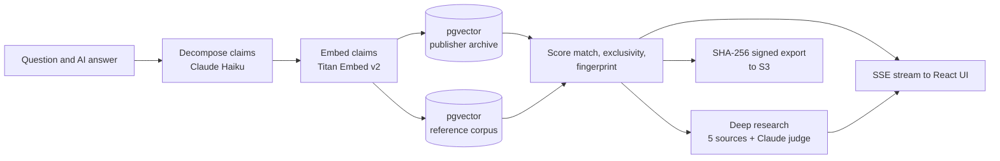

# CoMP Ledger

**Proves whether an AI model's answer came from a publisher's copyrighted reporting, and signs the evidence.**

**Winner, AWS Publishing & Media Innovation Hackathon, NYC (July 2026)**

## The problem

AI assistants repeat publishers' reporting, but model makers don't disclose their training data, so publishers can't prove which articles were used. CoMP Ledger works at inference time instead. It asks whether a model's answer is statistically unique to one publisher's reporting, and produces evidence a publisher can bring to a licensing negotiation.

## What it does

- Splits an AI answer into atomic factual claims with Claude Haiku on Amazon Bedrock.
- Embeds each claim with Amazon Titan Embed v2 and matches it against the publisher's archive and a public reference corpus in PostgreSQL with pgvector.
- Scores exclusivity: a claim that matches the publisher but few other sources scores high, common knowledge scores low.
- Deep Research mode checks each claim against Wikipedia, Google Search, OpenAlex, GDELT and the Wayback Machine, and a Claude Sonnet judge returns a verdict (confirmed, likely, unlikely or insufficient data).
- Streams claims to the UI over SSE as they are scored, and exports a SHA-256 signed evidence record to S3.

## Architecture



Exclusivity score:

```
baseScore        = max(0.05, 1 / (1 + independentSourceCount * 0.8))
fingerprintBonus = +0.15 if a distinctive phrase is detected
exclusivityScore = min(1.0, baseScore + fingerprintBonus)
```

| Score | Meaning |
|---|---|
| 0.7 to 1.0 | Few or no other sources: strong attribution signal |
| 0.4 to 0.7 | Some corroboration exists |
| 0.0 to 0.4 | Common knowledge: weak attribution case |

## Tech stack

| Layer | Technology |
|---|---|
| Backend | Node.js 20, Express (ESM), 40 REST endpoints, JWT auth |
| Also built in | Java 21 + Spring Boot 3.3.4 (Spring AI Bedrock Converse, DynamoDB) and Python FastAPI (asyncpg, pgvector) |
| AI | Amazon Bedrock: Claude Haiku 4.5, Claude Sonnet 4, Titan Embed Text v2 |
| Data | PostgreSQL 16 + pgvector |
| Research sources | Wikipedia, Google Custom Search, OpenAlex, GDELT, Wayback Machine |
| Frontend | React 18, Vite, Tailwind CSS |
| Storage and infra | AWS S3, Docker Compose |

## Results

- Won the AWS Publishing & Media Innovation Hackathon (NYC, July 2026), judged on innovation, AWS usage, publishing relevance, technical execution, business impact and presentation.
- Same pipeline implemented three ways: Node.js (main), Java with Spring Boot, and Python with FastAPI.

## Repository layout

| Folder | What it is |
|---|---|
| `comp-ledger/backend` | Main Node.js API (port 4001) |
| `comp-ledger/frontend` | React UI for the Node.js API |
| `comp-ledger/java-backend` | Spring Boot port (port 3001) |
| `comp-ledger/frontend-vamshi` | React UI wired to the Spring Boot port |
| `comp-ledger/backend-python` | FastAPI port (port 4001) |

## Run it locally

Needs Node 20, Docker and an AWS account with Bedrock access.

```bash
cd comp-ledger && docker compose up -d           # PostgreSQL 16 + pgvector
cd backend && cp .env.example .env               # add your AWS keys
npm install && npm run migrate && npm run dev    # API on :4001
cd ../frontend && npm install && npm run dev     # UI on :3000
```

Spring Boot version: `cd comp-ledger/java-backend && mvn spring-boot:run` (needs Java 21).
FastAPI version: `cd comp-ledger/backend-python && pip install -r requirements.txt && python run.py`.

Ingesting articles, the API reference and the evidence export format are in [docs/reference.md](docs/reference.md).

## License

MIT
